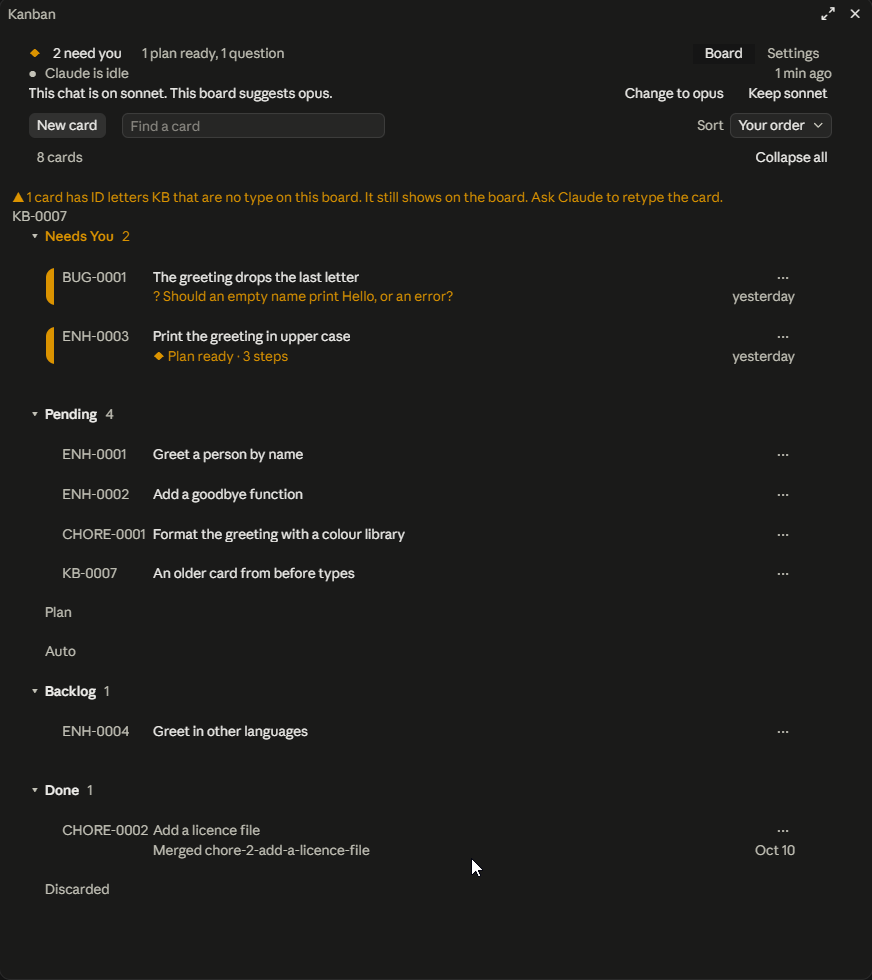
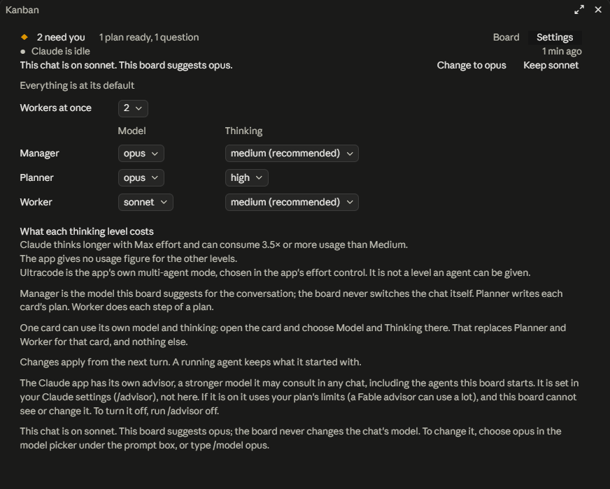

# kanban

A kanban board for Claude Code. Each card is a markdown file in your project's own `kanban/` folder, and a skill teaches Claude to run the board. A pane in the Claude desktop app lets you drag cards between lanes. Dropping a card on a lane makes Claude act: plan it, build it, or stop.



## Try it in a minute

You need the Claude desktop app (Code tab) and a project that is a git repo with one commit. In a terminal, once:

```
claude plugin install kanban --marketplace J-J-E/claude-kanban
```

Then open a **new** session in the project and type `/kanban:setup`. Claude writes `kanban/board.md` and the board pane opens. Press `New card`, type what needs doing and drag the card to `Plan`: Claude writes a plan into the card and asks you to approve it. Dragging a card to `Auto` makes Claude build it, commit it and merge it, so read "What Auto does on its own" below first, or try everything in the scratch project under "First run".

## Before you start

- **Claude Code:** checked on 2.1.296 on Windows 11, the only version and OS it has been checked on. macOS and Linux have not been tried. The commands in these docs are PowerShell; the equivalents are ordinary git commands.
- **The board pane** needs the Claude desktop app (Code tab). In the terminal CLI the skill still works by chat ("add a card", "move bug 1 to Plan", "list the board"); the pane, and the note that makes the chat the board's manager, are the desktop app's.
- **Node.js** (a current version) on PATH is needed only for the bundled MCP server (for other agents such as Gemini CLI) and for the scripts in `tools/` (the demo project, the private-text check, publishing). The board, the pane and the skill do not use it.
- **git:** the example below uses a git repo with one commit. Without git, Auto works in place: it makes no branch and no merge. With git it makes a branch and merges it. If the repo has a GitHub remote and `gh` is signed in, the merge is a pull request; otherwise it is a local merge.

## What Auto does on its own

Read this before you install. Dragging a card onto Auto (or saying "move bug 1 to Auto") is the go-ahead, and Claude then does all of this without asking again:

- plans the card first if it has no plan;
- creates a branch `<letters>-<n>-<slug>` (for example `bug-12-fix-the-date`) and has worker agents edit your code, committing each step;
- **merges into your default branch**: a squash-merged pull request through `gh` when there is a GitHub remote and `gh` is signed in, else a local `--no-ff` merge, then commits the board;
- starts subagents on the models in Settings (defaults: planner opus, worker sonnet; manager opus), which uses your Claude usage. The Claude app's own advisor (`/advisor`) is separate from this board: if it is on, the agents may consult it and it uses your plan's limits too; `/advisor off` turns it off;
- checks the work before it merges: the checks the plan names must pass on the branch with your default branch merged in, and the manager reads the whole diff. A number of changed files holds nothing;
- holds the merge and moves the card to Needs You when a gate trips: a changed path with words like `auth`, `token`, `secret` or `deploy`, a `.env*`, workflow or Dockerfile path, a dependency manifest or lockfile, a plan that deploys or deletes things, or a hit from the project's private-text check (`GATE: private text`) (the full list is under Gates in `skills/kanban/references/lanes.md`). Otherwise it merges verified work on its own. A check only the live pane can show never holds the card: Claude merges, records the check as NOT VERIFIED in `TESTING.md` and names it in its reply;
- stops after four failures of one step and puts the card in Needs You.

To stop a running card, drag it out of Auto to Pending or Backlog. Plan is gentler: it only writes a plan into the card and waits for you. Try everything first in a scratch project (the demo below).

## Install

One command, in a terminal:

```
claude plugin install kanban --marketplace J-J-E/claude-kanban
```

It adds this repo as a marketplace named `kanban-board` and installs the plugin `kanban` from it.

Or, as two commands (in a terminal, or inside a session as `/plugin marketplace add ...` and `/plugin install ...`). The first adds the marketplace; the second installs the plugin from it:

```
claude plugin marketplace add J-J-E/claude-kanban
claude plugin install kanban@kanban-board
```

Start a **new** session afterwards: sessions opened before the install do not have it. To confirm: `claude plugin list` shows `kanban@kanban-board`, `/board` opens the pane, and `kanban:kanban` and `kanban:setup` appear among the skills.

What has been seen: installed from the marketplace, the plugin's MCP server and skill ran from the installed copy. The board pane itself has so far been used from a development checkout, so if `/board` does not open after an install, please open an issue at https://github.com/J-J-E/claude-kanban/issues.

To remove it: `claude plugin uninstall kanban@kanban-board`, then `claude plugin marketplace remove kanban-board`. Both only undo the install; no project files are touched and your user settings are left as they were. The folder `C:\Users\<you>\.claude\plugins\cache\kanban-board` stays on disk (nothing loads it); delete it by hand if you want it gone.

## First run

In your project (a git repo with one commit works best):

1. Open a new Claude session in the project folder.
2. Type `/kanban:setup`. (`/kanban:kanban` and `set up the kanban board` do the same.)
3. The pane opens the moment you press Enter and says `This project has no board yet.` until the lanes appear. The board is created in one turn. Claude replies `Board ready for <owner>: Needs You, Pending, Plan, Auto, Backlog, Done, Discarded. /board opens it. Say "the owner is <name>" if <owner> is wrong.` If the pane does not open, type `/board`.

The owner is the first word of your git name; Claude asks `Whose board is this?` only when git has no name. The two new files, `kanban/board.md` and `kanban/DECISIONS.md`, are not committed. Typing `/kanban:kanban` in a project that already has a board runs `what's next` instead, and `/kanban:setup` or `set up the kanban board` there only replies `Board already set up at <path> (N cards). /board opens it.` A board is also never made inside another: if a folder above yours already has `kanban/board.md`, that is the board.

**Optional: a scratch project with sample cards**, six steps:

1. Make the demo project: `node <path-to-your-clone>/tools/make-demo.mjs <folder>`. [`tools/make-demo.mjs`](tools/make-demo.mjs) creates a small git project with one commit, a ready board and three sample cards. (You need a clone of this repo for that script.) Or start from an empty git repo that has one commit and, in the session, say `set up the kanban board`.
2. Open a new Claude session in that folder (desktop app, Code tab).
3. Type `/board`.
4. Add a card: `New card` in the pane, or say `add a card: ...`.
5. Drag it to Plan and read the plan that comes back in Needs You.
6. Drag it to Auto and watch it run, or drag it back to Pending to stop.

[`WALKTHROUGH.md`](WALKTHROUGH.md) is the full tour, with the expected output at each step.

## What you get

- **The skill, with lane actions.** Type `/kanban:setup` or say "set up the kanban board" to create the board, then say "add a bug: ...", "add an enhancement from bug 12: ...", "move bug 12 to Auto", "retype bug 12 as enhancement", "merge bug 12 into bug 8", "delete bug 12", "list the board", "what's next", "comment on bug 12: ..." or "decide: ...". Claude edits the card files and replies in a line or two. The lanes are Needs You, Pending, Plan, Auto, Backlog, Done and Discarded; the steps of each are in `skills/kanban/references/lanes.md`.
- **The pane.** `/board` opens it. A header says what Claude is on and how many cards `need you`, and its last row says which model the chat is on (`This chat is on opus.`; when that is not the model the board suggests, also `Change to opus` and `Keep sonnet`). The board never switches the chat's model: `Change to opus` copies `/model opus` for you to paste, and `Keep sonnet` makes sonnet the board's Manager model. A toolbar has `New card` (a title, a `Type` list and a `Lane` list), `Find a card`, `Sort`, and `Collapse all` / `Expand all`. Every lane is a flat row you can fold, and each card is one line with a bar of blocks for its plan. The `⋯` on a card opens a small menu: `Open card`, `Copy ID` and `Delete card…`. Pressing the card opens it: `Rename`, `Copy ID`, `◂ Prev` / `Next ▸`, the `Lane (move it)`, `Claude runs it with` (`Model` and `Thinking`) and `Card type` lists, `Show details` for the plan, a comment field and the Log, which can be copied. Above the lanes, a warning line says what is wrong with card files, one per kind of problem, with the next step and a `Show all` button for long lists (for ID letters that are no type: `Ask Claude to retype the card.`). If the pane cannot draw the board it says so in one line with a `Retry` button instead of staying blank. A `Board` chip above the chat box also opens the pane. The pane finds the board from the folder the chat was opened in or a parent folder, never from where a chat's command has since changed folder, and it never makes a board inside another.
- **The chat is the manager.** In the desktop app, what you type in a project that has a board is also read by Claude as the board's manager. A request that changes the project, such as `fix the date format in the summary`, becomes a card in Auto first (`BUG-0057 added to Auto: <title>`, with the type Claude judges it to be) and then runs like any other Auto card; `plan ...` puts it in Plan, and `later`, `idea` or `note` in Pending. A question or a read-only look makes no card, and an answer typed in chat goes to the card waiting on you and moves it on. Say `no card` in a request to skip the card for that request. The cost: a short hidden note (about 45 tokens, a little more when cards wait, and never a card title) rides on each prompt you type in a project with a board. It is not attached to slash commands, `Kanban:` prompts or scheduled runs.
- **Drops.** Plan or Auto starts a Claude turn for that lane's action. Pending and Backlog start nothing. Done and Discarded make Claude log the drop, clear the card's flag and name any unmerged work. Needs You refuses a drop: only Claude moves cards in, to ask a question, show a plan or hold a gated action. A card dropped on another card's rows (not on a lane's title bar or the gap between cards) is no move: the pane asks `Merge <ID> "<title>" into <ID> "<title>"?` with `Merge` and `Keep both`, and nothing is written until you press `Merge`. The card you dropped on keeps its place and gains the other card's text; the other card's file is deleted and its old ID still finds the survivor.
- **Settings.** The `Settings` tab has `Workers at once` and a `Model` and `Thinking` for the Manager, Planner, Worker (three roles; the Manager's model is the one the board suggests for your chat). They write to `kanban/board.md`. Under them a note says the Claude app has its own advisor, set with `/advisor` and not on this board. `Restore all defaults` undoes your changes, `Save as defaults` makes the current values this board's own defaults, and `Restore original defaults` removes those.

  
- **Obsidian (optional, experimental).** Say "set up the Obsidian view" and Claude writes `kanban/Board.base`, which Obsidian 1.14 or later should show as a Kanban board. The file format is covered by tests, but it has not yet been tried in a real Obsidian: nobody has dragged a card there and watched the pane follow. If you try it, please report what you see on the issues page. See [`docs/obsidian.md`](docs/obsidian.md).

## Card types, IDs and retyping

Every card has one type: `bug`, `enhancement` or `chore` unless the board's `types:` list says otherwise. The type shows in the ID, which is the type's letters and a number: `BUG-0012`, `ENH-0007`, `CHORE-0001`. Each type counts from 1 on its own, so `BUG-0001` and `ENH-0001` can both exist, and the next number of each type is kept in `kanban/board.md` as `next_bug`, `next_enh` and `next_chore`. Say `bug 12`, `bug-12` or `BUG-0012`; a bare `12` works only when one card has that number, otherwise Claude lists the candidates and changes nothing.

Choose the type when you add a card: the `Type` list in `New card`, or `add a bug: ...` in chat (`add an enhancement from bug 12: ...` also records that the new card came from bug 12). To change a card's type, pick another one in the `Type` list of the open card and answer the question, or say `retype bug 12 as enhancement`. The card takes the next number of the new type and its file is renamed; its branch, pull request and the text of other cards keep the old ID. The old ID still works: `bug 12` finds `ENH-0007` and the reply names both. A card being worked in Auto is not retyped. Claude retypes only when you ask. If the pane shows a warning that some cards have ID letters that are no type on the board, ask Claude, for example `retype KB-0001 as chore`.

**Merging.** Two cards about one thing can be merged: drop one on the other in the pane and answer `Merge`, or say `merge bug 12 into bug 8`. `BUG-0008` keeps its ID, lane and place; it gains `BUG-0012`'s text under `## Merged from BUG-0012: <title>` and a Log line, and `BUG-0012`'s file is deleted. Its old ID keeps working. Claude refuses when either card is in Auto, when the dropped one has a branch, a pull request or child cards, or when one is the parent of the other.

## Upgrading from an older copy

What changed: cards used to be `KB-0001` and `board.md` held `prefix: KB` and `next_id: <n>`. Now the ID letters come from the card's type, each type has its own counter line `next_<letters>` (for example `next_bug: 13`) in place of `prefix` and `next_id`, and there is a retype verb. A leftover `prefix:` or `next_id:` line is ignored and left as it is. The full rules are in `skills/kanban/references/format.md`, sections 6 and 7.

If a Claude session finds a board made by an older copy (cards named `KB-…`, a `prefix:` or `next_id:` line in `kanban/board.md`), do this, and never renumber a card or rename a card file by hand:

1. Leave the `prefix:` and `next_id:` lines alone.
2. Either keep the cards under their old letters, or retype them. Both can be done for different cards.
3. To keep the old letters, edit `kanban/board.md` and add a `types:` list that holds the three default types and one for the old letters, for example:
   ```
   types:
     - bug (BUG)
     - enhancement (ENH)
     - chore (CHORE)
     - legacy (KB)
   ```
   A `types:` list replaces the defaults, so the three default types must be in it. Add the line `next_kb: <the old next_id value>` so the number of a card that was deleted is not handed out again. The `KB-…` cards then have a type and keep their IDs.
4. To change a card's type instead, ask for it: `retype KB-0034 as bug`. The card gets the next `BUG-` number and the Log line `retyped from KB-0034 to BUG-0013`, and `KB-0034` keeps working as its old ID.
5. A `KB-…` card whose letters are no type on the board still shows and the board stays editable; the open card's `Type` list shows `No type`, and `list the board` reports `unknown-type` until step 3 or 4 is done.

## MCP server (optional)

The plugin also ships a stdio MCP server so other agents can read and edit the board. Tools: `board_list`, `whats_next`, `card_get`, `lanes`, `types` (lists each type and its letters), `card_add` (takes a required `type` and an optional `from`), `card_move`, `card_retype` (`id`, `type`, `who`), `card_merge` (`id` goes into `onto`, `who`), `card_comment`, `decision_add`; resources `kanban://skill`, `kanban://format`, `kanban://lanes`; a prompt `kanban_rules`. It only edits card files and never starts work. It finds `kanban/` as the nearest `kanban/board.md` at or above the folder it starts in, or the folder named by `KANBAN_DIR`.

In Claude Code there is nothing to connect: the plugin declares it, and it shows in `claude mcp list` as `plugin:kanban:kanban`. For Gemini CLI (`~/.gemini/settings.json`) or any MCP client that takes this block:

```json
{
  "mcpServers": {
    "kanban": {
      "command": "node",
      "args": ["C:/path/to/claude-kanban/mcp/dist/server.js"],
      "env": { "KANBAN_DIR": "C:/path/to/your/project/kanban" }
    }
  }
}
```

`args` is the absolute path to `mcp/dist/server.js` in your clone; `env` is optional.

## Contributing / developing the plugin

You do not need anything in this section to use the plugin.

**Dev loop.** Add an `env` key inside the existing top-level object of `C:\Users\<you>\.claude\settings.json` (use your clone's path; in JSON a Windows path needs doubled backslashes):

```json
"env": {
  "CLAUDE_CODE_PLUGIN_DIRS": "C:\\path\\to\\claude-kanban",
  "CLAUDE_CODE_PLUGIN_DIR_WATCH": "1"
}
```

Start a new session, or quit and reopen the desktop app if the plugin does not show. It has loaded when `kanban:kanban` appears in the `/` menu. With the watch flag, edits reload at the end of the turn that made them; if they do not, type `/reload-plugins`. A terminal `claude` may need `claude login` once. This setting is machine-wide: the plugin loads in every session on the machine until you remove the entry.

**A dev copy and an installed copy together.** Both can be installed: `claude plugin list` then shows `kanban@kanban-board` and `kanban@inline`, and sessions run the dev copy while the `env` entry exists. To use the installed copy, remove the `env` entry and restart the app. Overriding the entry from a project's `.claude\settings.local.json` did not switch the dev copy off. To run one terminal command against the installed copy alone, clear the variable in that shell and pass `--settings` (PowerShell 5.1): `$env:CLAUDE_CODE_PLUGIN_DIRS=''` then `claude --settings '{\"env\":{\"CLAUDE_CODE_PLUGIN_DIRS\":\"\"}}' plugin list`. That showed only `kanban@kanban-board`, and `mcp list` showed the MCP server running from the installed copy.

**Validate and test** (PowerShell, absolute paths, exit 0 on a pass). Checked on Claude Code 2.1.296, where the tests pass with or without `CLAUDE_CODE_ENABLE_FUNCTION_HOOKS`; CLI 2.1.284 needed it set, so setting it is harmless:

```powershell
$env:CLAUDE_CODE_ENABLE_FUNCTION_HOOKS = '1'
claude plugin validate <path-to-your-clone>
claude plugin test <path-to-your-clone>
```

`claude plugin test` is not listed in `claude plugin --help` but runs. The tests pass from any folder, including an installed copy's path. The MCP server has its own tests: `npm --prefix <path-to-your-clone>\mcp test`; rebuild its bundle after editing `mcp/src/` with `npm --prefix mcp run build`. [`TESTING.md`](TESTING.md) is a manual checklist.

**File layout.**

```
.claude-plugin/   plugin.json and marketplace.json
skills/kanban/    SKILL.md, plus references/format.md (the file format) and references/lanes.md (lane rules)
mcp/              the MCP server: src/ (TypeScript), dist/server.js (the bundle that runs), test/
hooks/            register.tsx (the pane), board.tsx (lanes and drag region), hooks/ui/, hooks/lib/
types/            the pane's state contract
tests/            claude plugin test files
tools/            helper scripts (make-demo.mjs with demo-files.mjs, capture-pane.ps1), the private-text check (private-check.mjs, private-allow.json, hooks/) and publish.mjs
docs/             obsidian.md and docs/design/ (the spec, drawing notes and screenshots)
kanban/           in your project, not this repo: board.md, DECISIONS.md and one card per BUG-0001-<slug>.md
```

**Keeping private text out.** `node tools/private-check.mjs` scans the tracked files (or `--staged`, `--diff <base>...<head>`, `--tree <folder>`) for secrets and keys, personal data (emails, phone numbers), paths on a PC, private names, session and cost figures, files that must never be tracked (`.env`, keys, local settings, logs) and, in a public copy, the private folders. A hit prints the file, the line and the first four characters, never the whole value; known harmless cases are listed with a reason in `tools/private-allow.json`. Exit 0 is clean, 1 is a hit. Private names come from a word list kept outside every repo, one word per line, in `~/.config/kanban/private-words.txt` (or the file named by `KANBAN_PRIVATE_WORDS`); without it that one class is skipped. To run it before every commit and push in your clone, once: `git config core.hooksPath tools/hooks` (`git config --unset core.hooksPath` turns it off). The board runs it on a card's changes before a merge and holds the card with `GATE: private text` on a hit, and `tools/publish.mjs` runs it before a publish ([`TESTING.md`](TESTING.md), Publishing).

## Problems and questions

Open an issue: https://github.com/J-J-E/claude-kanban/issues

## Licence

MIT, see [`LICENSE`](LICENSE). The bundled MCP server includes third-party packages; their licences are in [`THIRD-PARTY-NOTICES.md`](THIRD-PARTY-NOTICES.md).
