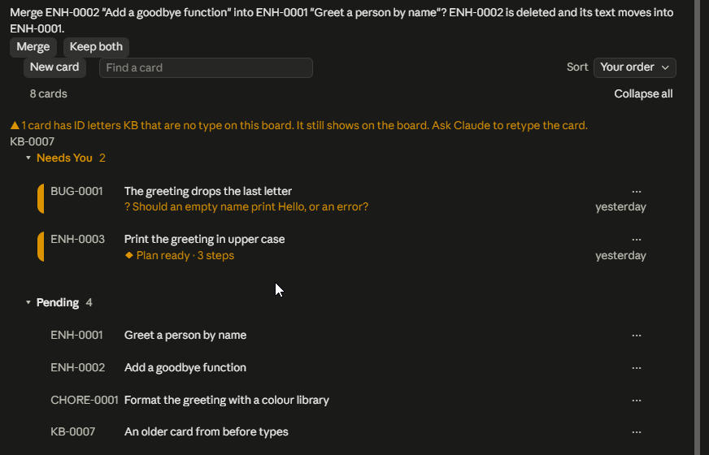
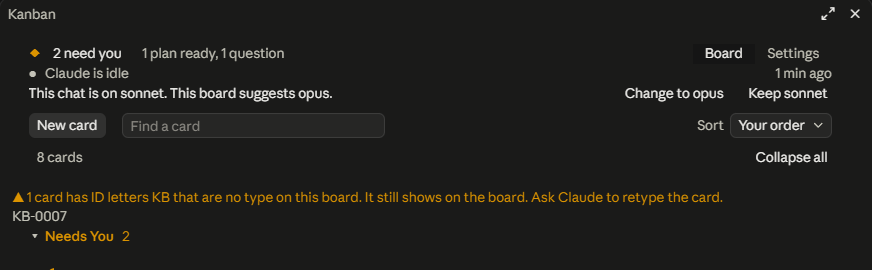
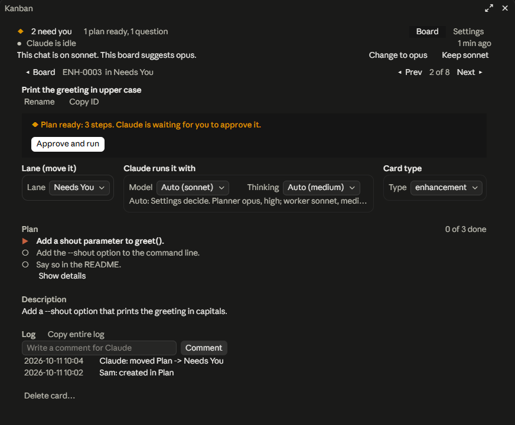

# Kanban walkthrough

A guided tour of the `kanban` plugin: set up a board in a scratch project, plan a card, let Claude build and merge it, meet a gate, and try the other chat verbs. Each step says what to do and what you should see. If you are an agent asked to run this tour for someone, do the steps in order and show them each "You should see" block next to what really happened.

What you need (versions, git, Node.js, what Auto does): `README.md`, section "Before you start". Install the plugin first (`README.md`, section "Install"), or load it from a clone (`README.md`, section "Dev loop").

**Short path for a desktop-app newcomer.** Everything happens in the Code tab and on the board; the chat tells you which lane to look in.

1. **Install.** In the Claude desktop app, open the Code tab. Click the `>_` button at the top right of the window to open the terminal panel. Paste this and press Enter; it reports that kanban was installed:
   ```
   claude plugin install kanban --marketplace J-J-E/claude-kanban
   ```
   Typing `/plugin marketplace add ...` in the desktop chat box does not add the marketplace; it only opens the plugin window, and this plugin does not show in that window's search.
2. **Start a new session** in the project folder (Code tab, new session). A session opened before the install does not have the plugin.
3. **Open the board.** Press the `Board` chip above the chat box, or type `/board`. The pane says `This project has no board yet.` Press `Set up a board` (or type `/kanban:setup`). Claude replies `Board ready for <owner>. On the board, drag ENH-0001 "Run through the sample workflow" from Pending to Plan to start the tour, or to Discarded to skip it. Say "the owner is <name>" if <owner> is wrong.`
4. **Start or skip the tour.** The board shows `ENH-0001 Run through the sample workflow` in Pending. Drag it to `Plan` to start the tour, or to `Discarded` to skip it.
5. **The tour, as board actions.** Claude makes two tickets in Pending. Drag `Add kanban-sample/hello.txt` to `Plan`; read its plan in `Needs You`; drag it to `Auto` to approve it. Drag `Add kanban-sample/goodbye.txt` straight to `Auto`. Each runs its test: the file holds exactly its one line. Then drag the tour card to `Done`. The chat tells you which lane to look in at each step; you never need to type.

Your output will differ from the examples in small ways. It shows your own name, your own dates and times (written `<date> <time>` below), your own commit hashes (`<hash>`) and whatever wording the planning agent picks for a plan. Card IDs below are `<ID>` (for example `ENH-0003`: the letters of the card's type, then its number) and `<n>` is the ID number without padding. Match the shape, not the exact text. Quoted messages in `backticks` that come from the skill or the pane are exact.

## 1. What you are looking at

- Each card is one markdown file in a `kanban/` folder inside your project.
- The lane a card sits in is one line of that file: `status:`.
- Dragging a card in the pane edits that line. A drop on a lane Claude acts on (Plan, Auto) also starts a Claude turn. Saying "move enhancement 1 to Auto" in chat does the same.
- Every card has one type, shown in its ID: `BUG-0012` is a bug, `ENH-0007` an enhancement, `CHORE-0001` a chore. Section 3 shows the numbers and section 7 how to retype.
- Claude, in your session, is the manager. It reads the cards, sends planning and work to agents, reviews what they return and commits. It never writes a plan or project code itself.
- Workers are subagents the manager starts. They edit the code and run the checks.

## 2. The lanes

In board order. "Who" is who may move a card in.

| Lane | Who | What happens |
|---|---|---|
| Needs You | Claude only | Holds everything that waits on you: a plan to approve, a question, a failure, or one held action (flag `GATE: ...`). Drag a held action out to Auto to approve it. If you drop a card here it bounces back. |
| Pending | you or Claude | Nothing. New cards and Claude's own suggestions land here. No turn starts. Drag a card on to Auto or Backlog. |
| Plan | you | A planning agent writes a numbered plan and Claude puts it into the card, sets the flag `PLAN READY`, moves the card to Needs You, stops. |
| Auto | you | Claude runs the card start to finish: branch, workers, a commit per step, merge, Done. Drag a running card out to Pending or Backlog to pause it. |
| Backlog | you or Claude | Ideas that may or may not be done. Nothing happens to a card here. No turn starts. |
| Done | Claude or you | Finished. If you drop a card here, Claude Logs it, clears a flag the card was waiting on, and reports any unmerged work. |
| Discarded | you | Abandoned. Claude Logs it and names the branch for you to delete. It deletes nothing. |

Every lane is a full-width row you can fold: press its bar (the `▾` or `▸`, the name and the count) to fold or open it. A lane with no cards is one quiet line with its name. A board made earlier may still list Manual, Parked or Gated lanes. It loads and works, but the default board has none of them.

Flags show on a card as a badge:
- `PLAN READY`: the plan waits for your OK (in Needs You).
- `QUESTION: ...`: Claude needs an answer first (in Needs You). Comment, then drag the card on.
- `FAILED`: a step failed four times (in Needs You).
- `GATE: <reason>`: the held action (in Needs You).

What the pane shows about work in progress:
- A card with a plan has a bar of blocks and a count, like `5/7` (steps done of steps). A card a worker is on says `● Working`, and the line under the bar says which step.
- A card whose turn is queued says `○ Waiting to start`.
- A lane's bar says `● 1 working` or `2 need you` on its right.
- The header says `Claude is on <ID>` (or `Claude is idle`) and, when something waits on you, `◆ 3 need you`. Press it to open the first waiting card.
- The last row of the header says which model your chat is on, for example `This chat is on opus.` The board never switches the chat's model (section 4, Settings).

## 3. Start from the demo project

The tour starts from a small demo project: a git repo with one commit, a ready board and three sample cards. Make it with the script in this repo (you need a clone of it). `<path-to-your-clone>` is the folder you cloned, `<folder>` a new folder name:

```
node <path-to-your-clone>/tools/make-demo.mjs <folder>
```

It needs Node.js (see `README.md`, "Before you start"). It only creates files inside `<folder>`; the script lives in `tools/make-demo.mjs`.

No clone, or no Node.js? Make the project by hand instead: an empty git repo with one commit. These lines work in PowerShell and in bash or zsh, and make one new folder and one commit (they remove nothing). The commit matters: Auto makes its branch from your default branch, so that branch needs a commit.

```
mkdir hello-board
cd hello-board
git init -b main
git commit --allow-empty -m "Initial commit"
```

If the commit says it does not know who you are, run `git config user.name "<your git name>"` and `git config user.email "<you@example.com>"` in that folder, then repeat the commit.

Card numbers: each type counts from 1 on its own. On this hand-made repo your first bug is `BUG-0001` and your first enhancement is `ENH-0002` (`ENH-0001` is the tour card). The demo has two enhancements and a chore, `ENH-0001`, `ENH-0002` and `CHORE-0001`, so a bug you add is `BUG-0001`, an enhancement `ENH-0003` and a chore `CHORE-0002`.

Install first. In the Code tab, click the `>_` button at the top right to open the terminal panel and run `claude plugin install kanban --marketplace J-J-E/claude-kanban` (typing `/plugin marketplace add ...` in the chat box does not add the marketplace). Then start a new session in the project folder: in the Claude Code desktop app, the Code tab with that folder chosen. Sessions open before the plugin was installed do not have it. Then check:
- Type `/`. The menu lists `kanban:kanban` and `kanban:setup`.
- Type `/board`. With the demo, the pane opens on the board. On the hand-made repo it says `This project has no board yet.` with a `Set up a board` button. Once a project has a board, a `Board` chip also shows above the chat box while the pane is closed; pressing it opens the pane the same way.

If `kanban:kanban` or `kanban:setup` is missing, quit the desktop app and reopen it, then start a new session. The skill also starts on its own when you say "set up the kanban board", "add a bug", "move enhancement 1 to Auto", "what's next", "list the board" or "decide".

## 4. Set up the board

Skip to the pane tour below if you made the demo: its board is already set up. Typing `/kanban:kanban` there runs `what's next`, and `/kanban:setup` or `set up the kanban board` only answers `Board already set up at <path of board.md> (3 cards). /board opens it.`

On the hand-made repo, press `Board` above the chat box (or type `/board`); the pane says `This project has no board yet.` and `Your first card will be a short tour: drag it to Plan to start.` Press `Set up a board` (or type `/kanban:setup`). The pane says the same until the lanes appear. Claude takes the first word of your git name as the owner and asks nothing (it asks `Whose board is this?` only when git has no name). It replies:
```
Board ready for <owner>. On the board, drag ENH-0001 "Run through the sample workflow" from Pending to Plan to start the tour, or to Discarded to skip it. Say "the owner is <name>" if <owner> is wrong.
```

If the pane does not open, type `/board`. If `<owner>` is wrong, say `the owner is <name>` and Claude replies `Owner is now <name>.` (The `Set up a board` button in the pane, `/kanban:kanban` and `set up the kanban board` do the same thing as `/kanban:setup` here.) Two files appear in `kanban/`: `board.md` and `DECISIONS.md`. Nothing is committed yet. Type `/kanban:kanban` again and Claude prints the `what's next` list; saying `set up the kanban board` again replies `Board already set up at <path of board.md> (0 cards). /board opens it.` and creates nothing. That holds from a subfolder or from inside `kanban/` too: a board is never made inside another.

`kanban/board.md` as the setup writes it:
```
---
owner: <you>
lanes:
  - Needs You (needs-you)
  - Pending (intake)
  - Plan (plan)
  - Auto (auto)
  - Backlog (backlog)
  - Done (done)
  - Discarded (scrapped)
---
# Board notes

```

`lanes:` is the board order; the word in brackets is the lane's role. A setting you change in the pane adds one line just before the closing `---`. The file has no `types:` list yet, so the board has the three default types: bug (`BUG`), enhancement (`ENH`) and chore (`CHORE`). Adding a card writes a counter line for its type, the type's letters in lowercase, such as `next_bug: 2` after the first bug; no line means the type's next number is 1. To add a type of your own, add a `types:` list (for example above `lanes:`) with all the types you want, since the list replaces the defaults:
```
types:
  - bug (BUG)
  - enhancement (ENH)
  - chore (CHORE)
  - docs (DOCS)
```
The demo board shows the counters: `next_enh: 3` and `next_chore: 2`, because it already holds `ENH-0001`, `ENH-0002` and `CHORE-0001`.

The pane shows the header (`Claude is idle`, the `Board` and `Settings` tabs, when it last changed, and a last row that says which model the chat is on), the toolbar and the lanes (picture: `docs/design/real-pane-board-with-menu.png`):


- `New card`: opens a `What needs doing?` field with a `Type` list (the board's types; the card gets that type's letters and that type's next number) and a `Lane` list (pick where the card goes), `Add` and `Cancel`. Enter also adds. The pane writes the card file itself. If the lane is one Claude acts on (Plan or Auto), a Claude turn starts for it; in Pending nothing runs.
- `Find a card`: type to show only the cards that match; `Clear` empties it. If nothing matches the pane says `No card matches "zzzz"` with another `Clear` (picture: `docs/design/real-pane-find-none.png`). Enter opens the first match.
- `Sort`: `Your order`, `Newest first`, `Oldest first`, `Recently changed`, `Title A to Z`, `Label A to Z`, `Needs you first`. A sort changes no card file. You can only drop a card between two others while it is `Your order`.
- `Collapse all` / `Expand all`: folds or opens every lane (picture: `docs/design/real-pane-all-folded.png`). A line like `3 cards` counts what is shown.
- Each card is a flat row: its ID, its title and a `⋯` button. Press the row to open the card. Press the `⋯` to show a small menu under the card: `Open card`, `Copy ID` and `Delete card…` (which asks `Delete it` or `Keep it`; `Delete it` asks Claude to delete the card, with the toast `Claude is deleting <ID>.`, and Claude replies `<ID> deleted.`).
- Drag a card and let go on another card's rows, not on a lane's title bar or the gap between cards: the card does not move. The top of the board tab asks `Merge <ID> "<title>" into <ID> "<title>"? <ID> is deleted and its text moves into <ID>.` with `Merge` and `Keep both`. `Keep both` drops the question and changes nothing. `Merge` asks Claude (section 7, Merge). While the card is held, the lane under it says `Merge into <ID>`. A card in Auto cannot be merged: the toast is `<ID> is being worked. Move it out of Auto or wait, then merge. Nothing was changed.` (picture: `docs/design/real-pane-merge-question.png`)



When a card file has a problem, a warning line above the lanes says what, in full, and what to do next: one line per kind of problem, with the first three cards or files and a `Show all` button (then `Show fewer`) for the rest. A card whose ID letters are no type on the board reads `▲ 1 card has ID letters KB that are no type on this board. It still shows on the board. Ask Claude to retype the card.` with its ID under it; section 7 shows the retype. If the pane cannot draw the board at all, it shows one line, `kanban: the board could not be drawn: <reason>`, and a `Retry` button, never a blank pane (picture: `docs/design/real-pane-problem-line.png`).



The Settings tab (picture: `docs/design/real-pane-settings.png`) has `Workers at once`, and a `Model` and a `Thinking` list for each of three roles (Manager, Planner, Worker), each with its default and a `Reset` button. There is no Advisor row.


Each Thinking list marks the level the app recommends for the role's model; changing a role's model does not change its thinking. `Restore all defaults` asks `Restore` or `Keep`. `Save as defaults` makes the current settings this board's own defaults at once (`Saved as your defaults.`): each row's default, its `Reset` and `Restore all defaults` then use them, and no other board changes. `Restore original defaults` (shown only when the board has saved defaults) asks `Remove your saved defaults and put every setting back to the original?` with `Restore` or `Keep`. The shipped defaults are Workers 2; Manager opus, medium; Planner opus, high; Worker sonnet, medium. Under the settings, notes explain the three roles and then say that the Claude app has its own advisor, set in your Claude settings with `/advisor` and not here: if it is on it uses your plan's limits, the board cannot see or change it, and `/advisor off` turns it off. The controls write to `board.md`:
- `workers`: how many agents the manager runs at once, planning agents and step workers together. Default 2.
- `manager_model`: the model the board suggests for your chat. Default opus, medium. The board never switches the chat's model: the header says which model the chat is on and offers `Change to opus` (copies `/model opus`) and `Keep sonnet` (makes the chat's model the board's Manager model).
- `planner_model`: what the planning agents run on. They write the plans; the manager reviews each plan and writes it into the card. Default opus, high.
- `worker_model`: what each worker runs on. Default sonnet, medium.

### The tour card

A new board starts with one card in Pending, `ENH-0001 Run through the sample workflow` (label `tour`). It is a guided run through Plan and Auto, so you can try the board before using it on real work. Nothing is made until you decide:

- **Accept:** drag it to Plan (Auto also works), or say `start the tour`. Claude makes two tickets (the files will say `Hello from the board.` and `Goodbye from the board.`; tell Claude before you drag the first ticket if you want other wording) in Pending, `Add kanban-sample/hello.txt` and `Add kanban-sample/goodbye.txt`, each with a test case. You drag the first to Plan, read its plan in Needs You and approve it by dragging it to Auto; you drag the second straight to Auto. The tour card's checklist is ticked as you go, and its Log says where the tour stands, so a later session picks it up where it stopped.
- **Reject:** drag it to Discarded, or say `skip the tour`. Claude replies `Tour skipped. Nothing was created.`
- **Finish:** drag the tour card to Done. Claude says `Tour done. kanban-sample/ can be deleted.` What is left: two Done tickets, their merged commits and the `kanban-sample/` folder with two one-line files. Nothing is deleted for you.

Because the tour card is the board's first enhancement, your own first enhancement on a new board is `ENH-0002`.

## 5. Plan a card and let Claude run it

**Before the first drag to Auto, know what it does.** Auto is the go-ahead for Claude to make a branch, edit your files, commit each step and merge the branch into your default branch, with subagents on the models in Settings (this uses your Claude usage). That is why this tour uses a scratch project. The full list is `README.md`, section "What Auto does on its own". Plan is gentler: it only writes a plan into the card and waits.

**Pick a card.** With the demo, use one of the three sample cards in Pending (the first, `ENH-0001`, is the simplest). On the hand-made repo, or if you would rather use your own, add one. In chat, type:
```
add an enhancement: Hello world app. A tiny Python program, hello.py, that prints Hello, world and a test that checks it. Keep it to one file plus the test.
```

Claude replies `<ID> added to Pending: Hello world app`. Or press `New card` in the pane, type `Hello world app` in `What needs doing?` and press `Add`: the card shows in Pending at once. The pane way leaves the body empty for a short title; text longer than 120 characters becomes the body, with the title cut at a word and ended with `…`, and the toast says the full text is in the card. The file is `kanban/<ID>-hello-world-app.md` with `status: Pending` and one Log line: `<date> <time> <you>: created in Pending`.

**Plan it.** Press on the card in the pane, move to the Plan lane, let go (while you drag, the lane under the pointer says what the drop will do, such as `→ Drop and Claude writes a plan.`). Or type `move <ID> to Plan` (for example `move enhancement 1 to Plan`), or open the card and pick Plan in its `Lane` list. The card jumps to Plan. Your chat gets a message that looks like you typed it:
```
Kanban: <you> moved <ID> "<title>" from Pending to Plan. Do the plan lane action from the kanban skill.
```

A planning agent writes the plan, Claude reviews it, puts it in the card and replies in one line, like `<ID> planned: 2 steps, waiting in Needs You.` The card is now in Needs You with the badge `PLAN READY`. Open the file. The plan is in it, one numbered step per line, each naming the files it touches and how it is checked (the wording is the planning agent's, this is the shape):
```
## Plan
1. <what to build>. Files: <files>. Check: <command that proves it>.
2. <what to build>. Files: <files>. Check: <command that proves it>.

## Log
- <date> <time> <you>: created in Pending
- <date> <time> <you>: moved Pending -> Plan
- <date> <time> Claude: moved Plan -> Needs You
```

A plan can end with a "To settle when you approve" list: questions with the answer Claude will assume, in brackets. If one is wrong, say so with `comment on <ID>: ...` before you approve.

**Run it.** Not happy with the plan? Type `comment on <ID>: ...`, then drag the card back to Plan. Happy? Drag the card from Needs You to Auto. Claude does the Auto flow:
1. Clears `PLAN READY`, makes the branch `<letters>-<n>-<slug>` (for the hello world enhancement, `enh-1-hello-world-app`) from your default branch (`main` if there is no `origin/HEAD`), writes it in `branch:`.
2. Starts a worker for the plan's steps (one worker may take several in a row). The card shows `● Working`, the header says `Claude is on <ID>` and, with `Workers at once` above 1, `1 of 2 workers`.
3. Reviews each worker's diff, then commits that step on the branch.
4. Verifies: the checks the plan names pass on the branch with your default branch merged in, and the manager reads the whole diff. It Logs `reviewed: <n> files, <checks> pass, nothing outside the plan`.
5. Checks the changed files for a gate (section 6). An ordinary source file and its test hit none.
6. Merges. With no GitHub remote it is a local merge into the default branch. With a GitHub remote and a signed-in `gh` it opens a pull request and squash-merges it. If the Settings tab's `Merge by` is `Owner`, or the merge is refused (the app's safety check in auto mode, say) or `gh` cannot run, Claude stops before the merge instead: the card goes to Needs You flagged `READY TO MERGE`, drawn green, with the link and the one command in its Log. You merge it yourself, then drag the card to Auto and Claude finishes it.
7. Moves the card to Done and commits the board.

Expect the normal permission prompts for Edit, Write and Bash. The `Kanban:` message arrives as your own words, so nothing is pre-approved. Approve them.

The card's Log when it finished has this shape:
```
- <date> <time> <you>: created in Pending
- <date> <time> <you>: moved Pending -> Plan
- <date> <time> Claude: moved Plan -> Needs You
- <date> <time> <you>: moved Needs You -> Auto
- <date> <time> Claude: started: <letters>-<n>-<slug>
- <date> <time> Claude: step 1 done: <what>
- <date> <time> Claude: step 2 done: <what>
- <date> <time> Claude: reviewed: <n> files, <checks> pass, nothing outside the plan
- <date> <time> Claude: merged <letters>-<n>-<slug>
- <date> <time> Claude: moved Auto -> Done
```

A worker may add a free comment between these, for example when a check tool is missing and it used another. The card file has `status: Done` and `branch: <letters>-<n>-<slug>`. Check the work itself: for the hello world card, `python hello.py` in the project folder prints `Hello, world`. The git history (`git log --oneline --graph`) has this shape, with your hashes and your default branch name:
```
* <hash> <ID> board: done
*   <hash> <ID> <card title>
|\
| * <hash> <ID> step 2: <what>
| * <hash> <ID> step 1: <what>
|/
* <hash> Initial commit
```

## 6. A gate

Some changes are held for your approval instead of being merged. Make one on purpose with a card that asks for a new dependency. If the board has a sample card that asks for one, use it. Otherwise add one in chat:
```
add a card: Add a dependency. Add one small third-party package to this project's dependency file (requirements.txt for Python, package.json for Node) and use it in one place.
```

Drag it from Pending straight to Auto. Auto writes its own plan first (a card with no plan is planned inside the Auto flow, without stopping at `PLAN READY`), makes the branch, and the workers add the dependency file and the code. Before the merge, Claude lists the changed files. A requirements file, `package.json` or a lockfile is a dependency manifest, so Claude stops and moves the card to Needs You with the flag `GATE: merge touches <that file>` (for example `GATE: merge touches requirements.txt`). The Log has this shape:
```
- <date> <time> <you>: created in Pending
- <date> <time> <you>: moved Pending -> Auto
- <date> <time> Claude: started: <letters>-<n>-<slug>
- <date> <time> Claude: step 1 done: <what>
- <date> <time> Claude: step 2 done: <what>
- <date> <time> Claude: reviewed: <n> files, <checks> pass, nothing outside the plan
- <date> <time> Claude: GATE: merge touches <manifest file>
- <date> <time> Claude: moved Auto -> Needs You
```

If your card did not gate, its plan did not change a manifest file; read the Log and the branch's changed files (`git diff --name-only <default branch>...<branch>`) and see the list below.

Other gates: auth, login, secret or deploy paths, `.env*`, workflows, a `Dockerfile`, a dependency file, a deploy or a destructive step, and a hit from the project's private-text check, which holds the card with `GATE: private text` (full list: "Gates" in `skills/kanban/references/lanes.md`). Anything else Claude merges on its own once the checks pass; the number of files changed holds nothing. A check only the live pane can show (a look, a drag) never holds the card either: Claude merges, Logs `not verified in the live app: <what> (TESTING <step>)`, writes the step into `TESTING.md` as NOT VERIFIED and names it in its reply.

**What your drag does.** Drag the card from Needs You to Auto. That approves the one held action and nothing else. Claude Logs `started: <letters>-<n>-<slug>`, then `approved: GATE: merge touches <manifest file>`. It clears the flag and merges the branch into your default branch. It Logs `merged <letters>-<n>-<slug>`, moves the card to Done and commits the board as `<ID> board: done`. Dropping a card into Needs You yourself does not work: that lane says `Claude's lane. You can't drop here.`

Until you approve, the branch has its commits and is not merged: on your default branch the project is unchanged, and `git status` shows one change, the card file, not committed. That is expected.

## 7. The other verbs, in chat

You type the phrase. Claude edits the card files and replies in one or two lines.

- **List.** `list the board`. Each lane as `Lane (n)`, its cards under it as `ID title [flag]`. With a gated card waiting and one card Done it looks like this:
```
Needs You (1)
  <ID> Add a dependency [GATE: merge touches <manifest file>]
Pending (n)
  <ID> <title>
Plan (0)
Auto (0)
Backlog (0)
Done (1)
  <ID> Hello world app
Discarded (0)
```

If a card file has a problem, the list ends with one `Fix needed:` line that names it by code (`unknown-lane`, `duplicate-id`, `unknown-type`) and nothing is fixed. For `unknown-type` a second line follows: `To fix unknown-type: retype each card to a type on this board (bug, enhancement or chore here), e.g. "retype KB-0001 as chore".`

- **What's next.** `what's next`. Four headings, each item as `ID title [flag]` (Left hanging: `ID title - last Log <age> ago`); an empty one says `none`:
```
Queued for Claude
  none
Waiting on you
  <ID> Add a dependency [GATE: merge touches <manifest file>]
Untriaged
  <ID> <title>
Left hanging
  none
```

- **Move.** `move enhancement 1 to Auto`. Claude replies `ENH-0001 moved Pending -> Auto.`, then runs the lane's action. It is the same go-ahead as a drag. `Needs You` is refused: `"Needs You" can only be entered by Claude (it holds a question, a plan to approve or a held action). Nothing was changed.` An unknown lane gets `Unknown lane "Nowhere". Lanes on this board: Needs You, Pending, Plan, Auto, Backlog, Done, Discarded. Nothing was changed.`
- **Comment.** `comment on enhancement 1: waiting on Sam`. Reply `Comment added to ENH-0001.` It adds the Log line `<you>: waiting on Sam`. The lane does not change.
- **Decide.** `decide: Python for the sample app, because it needs no build step`. Reply `D1 recorded: Python for the sample app`. The line in `DECISIONS.md`:
```
- **D1 (<date>) Python for the sample app:** <the decision>. Reason: it needs no build step.
```

If you give no reason, Claude asks once. To change a decision, say so; a new line ends `Supersedes D1.` and the old line stays.

- **Add a card of a type, or from another card.** `add a bug: the footer overlaps the text` makes the next bug, `BUG-0001` on a board with none, and replies `BUG-0001 added to Pending: <title>`. If you name no type Claude asks once `Bug, enhancement or chore?`. `add an enhancement from bug 1: let the footer collapse` makes `ENH-0003` on the demo board and adds the Log line `spawned from BUG-0001` to it and `spawned ENH-0003: <title>` to `BUG-0001`. Neither card becomes the other's parent.
- **Retype.** `retype bug 1 as enhancement`. The card takes the next enhancement number, the file is renamed (`BUG-0001-<slug>.md` becomes `ENH-0004-<slug>.md`, same slug), and Claude replies `BUG-0001 is now ENH-0004.` The Log gets `retyped from BUG-0001 to ENH-0004`. The card's `branch:`, its pull request and the mentions of `BUG-0001` in other cards keep the old ID, and a child card's `parent:` is changed to the new ID. Claude retypes only when you ask. A card in Auto, or one an agent is on, is refused: `BUG-0001 is being worked. Move it out of Auto or wait, then retype. Nothing was changed.` A type the board does not have is refused: `Unknown type "epic". Types on this board: bug, enhancement, chore. Nothing was changed.` In the pane, use the `Type` list of the open card (section 8); it asks Claude to do this. For cards whose ID letters are no type on the board (the pane's warning line, section 4), say `retype KB-0001 as chore`, or say yes when Claude offers it after `list the board`: Claude picks a type from what each card is (a defect is a bug, a new ability an enhancement, upkeep or docs a chore), retypes each one and replies one line per card, `KB-0001 is now CHORE-0011.`
- **Merge.** `merge bug 2 into bug 1`, or drop one card on another in the pane (section 4). The first card goes into the second, which keeps its ID, lane and place. Claude adds the first card's text to the second under `## Merged from <ID>: <title>`, joins the labels, adds the Log line `merged <ID> "<title>" into <ID>`, deletes the first card's file and replies `BUG-0002 merged into BUG-0001.` Nothing else changes, and no counter goes back. The merged card's old ID finds the survivor, as after a retype. Refused, with nothing changed: `<ID> cannot be merged into itself. Nothing was changed.`, `<ID> is being worked. Move it out of Auto or wait, then merge. Nothing was changed.`, `<ID> is the parent of <ID>, so they cannot be merged. Nothing was changed.`, `<ID> has work on <branch or pr> and cannot be merged. Nothing was changed.` and `<ID> has child cards: <IDs>. Delete or re-parent them first. Nothing was changed.`
- **Delete.** `delete bug 2`, for a duplicate or junk card (work worth keeping goes to Discarded instead). Claude deletes the file and replies `BUG-0002 deleted.` Its number is not handed out again. A card with a branch or pull request is refused: `BUG-0002 has work on <branch or pr>. Move it to Discarded, or say "delete bug 2 anyway".`
- **An old ID is followed.** After the retype, `comment on bug 1: still waiting` reaches `ENH-0004` and replies `Comment added to ENH-0004 (was BUG-0001).` `BUG-0001` is never handed out again.
- **A bare number.** `move 1 to Backlog` works only when one card has the number 1. With `BUG-0001` and `ENH-0001` on the board Claude replies `More than one card is numbered 1: BUG-0001, ENH-0001. Say which, for example "bug 1". Nothing was changed.` and changes nothing.
- **Backlog.** `move enhancement 2 to Backlog`. Claude replies `ENH-0002 moved Pending -> Backlog.` and does nothing else. The card waits there, and `what's next` does not list it.
- **Pausing.** `move enhancement 2 to Pending` (or Backlog) while Auto is running it. Claude stops at the next safe point, commits no work in progress, Logs `stopped at step <n>`, keeps the flag and branch, and commits the board as `ENH-0002 board: stopped`.
- **Discarded.** `move enhancement 2 to Discarded`. Claude stops, Logs `scrapped at step <n>; branch <branch>, PR <pr or none> left for you to close`, clears the card's flag the same way a drop on Done does (the Log line then ends `; cleared flag <the old text>`), commits the board as `ENH-0002 board: scrapped` and replies with the branch and PR for you to delete. It deletes nothing.

**Ask in chat.** In a project with a board, the chat is the board's manager: the pane quietly attaches a short note to what you type (not to slash commands). Type a request that changes the project:
```
fix the date format in the summary
```
Claude makes the card before doing anything else and replies `<ID> added to Auto: Fix the date format in the summary`. The card shows in Auto, the header reads `Claude is on <ID>`, and a planning agent starts on it. A question (`what does the summary function do?`) makes no card, and `no card: fix the typo in the README` skips it. `plan ...` puts the card in Plan; `later ...`, `idea ...` or `note ...` in Pending.

When a card waits in Needs You, answer it in chat. With one card waiting, type `yes go ahead`: the card's Log gets `<you>: yes go ahead` and `<you>: moved Needs You -> Auto`, and Claude starts it. With two waiting, a bare `yes` gets `Which card: <ID> or <ID>?`; name one.

## 8. The open card

Press a card (or choose `Open card` in the menu under its `⋯`) and the pane shows that card alone (picture: `docs/design/real-pane-open-card.png`):



- Top row: `◂ Board` goes back to the lanes. `◂ Prev`, a count like `4 of 32`, and `Next ▸` step through the cards in board order.
- The title, with `Rename` (opens a `Card title` field with `Save` and `Cancel`) and `Copy ID` (puts the ID on the clipboard and shows `Copied <ID>.`).
- The Log: press a line's date to copy the whole line (the words are plain text that wraps; pressing them does nothing). Expect `Copied the Log line.`, and Ctrl+V pastes the date, time, name and words, for example `2026-10-11 02:09 John: created in Auto`. Under a line that holds text between backticks is a `Copy command` button for each such stretch: expect `Copied the command.`, and Ctrl+V pastes only the command, exactly as written (`Copy command 1`, `Copy command 2` when a line holds several). Beside the `Log` heading, `Copy entire log` copies every line, also the ones hidden until `Show the whole log`, one per row, oldest first: expect `Copied the entire log.` A card with no Log lines has no `Copy entire log`. These write nothing and send nothing to Claude.
- A status box when Claude is on the card: `Working`, the step, the bar of blocks and `5 of 7 steps done`, the last Log line, the branch and pull request.
- A card that waits on you has one button in its status box: `Approve and run` (a plan), `Approve and continue` (a held step) or `Retry in Auto` (a failed card). It moves the card to Auto and returns to the lanes; if the press is refused the card stays open and a toast says why.
- `Lane`, `Model`, `Thinking` and `Type`, in three groups, each under a bold heading and inside its own outline: `Lane (move it)` (bright outline), `Claude runs it with` (`Model` and `Thinking`, dim outline) and `Card type` (`Type`, dim outline). In a wide pane the three sit side by side, in a narrow one one under another, in that order; in between, `Lane (move it)` and `Card type` share a row and `Claude runs it with` follows. `Lane` moves the card, with the same effect as a drag. `Type` shows the card's type (`No type` for a card whose ID letters the board does not list). Picking another type writes nothing: the pane asks `Retype BUG-0012 as enhancement? Its ID will change.` directly under the `Card type` group, with `Retype` and `Cancel`, and `Retype` asks Claude, which renames the card (section 7). The header then reads `ENH-0007 (was BUG-0012)`. `Model` and `Thinking` set a model and thinking level for this card alone; they replace the Planner and Worker settings for that card and nothing else. `Auto` means the Settings values apply.
- `Plan`: one line per step, marked done, current or to do. `Show details` draws every step in full; `Hide details` puts it back.
- `Description`, then `Log`: a `Write a comment for Claude` field (`Type your answer` when the card waits on a question) with a `Comment` button, and the Log lines, newest first.
- `Delete card…` at the bottom asks `Delete <ID>? This removes the card and its log.` with `Delete it` and `Keep it`.

## 9. Watch the board in Obsidian

Status: experimental. The pane's handling of a move made in Obsidian is covered by tests, but the `Board.base` file is not (Claude writes it from the steps in the skill's verbs), and this section has not yet been tried in a real Obsidian; what follows is what should happen, read from Obsidian's behaviour.

Obsidian 1.14 or later (read from 1.14.4) can show the board as a Kanban view of one file, `kanban/Board.base`, with no plugin. A drag there should change only the card's `status:`; the pane should then add the Log line `moved A -> B in Obsidian`. By design a drag cannot place a card between two others, a card whose `flag:` holds a colon (such as `GATE: ...` or `QUESTION: ...`) cannot be dragged there, and whether empty lanes show as columns is unknown (details in `docs/obsidian.md`).

The simplest setup is to make your project folder the vault:
1. In Obsidian choose "Open folder as vault" and pick the project folder (the one that holds `kanban/`). Obsidian adds a `.obsidian/` folder there; add `.obsidian/` to the project's `.gitignore`.
2. In a session in that project say `set up the Obsidian view`. Because the vault is the project, Claude writes the file without asking and replies `Obsidian view written: kanban/Board.base. Open it in Obsidian 1.14 or later; a card dragged there changes only its status.` It does not commit. Say it again after you add or rename a lane.
3. In Obsidian open `kanban/Board.base`. Drag a card to another column; its `status:` should change. Whether Obsidian rewrites the card file as `docs/obsidian.md` predicts has not been confirmed on a real drag.

If your vault is somewhere else, link the project's `kanban/` folder into it (a folder shortcut, so the files stay in the project): on Windows in cmd.exe, `mklink /J "<vault>\<project>" "<project folder>\kanban"`; on macOS or Linux, `ln -s "<project folder>/kanban" "<vault>/<project>"`. Each makes one link and removes nothing. Then `set up the Obsidian view` asks `What is the path of this kanban folder inside your Obsidian vault?`; answer `<project>`. To remove the link later, on Windows `rmdir "<vault>\<project>"` in cmd.exe, elsewhere `rm "<vault>/<project>"`. That deletes only the link, not the cards.

## 10. The MCP server

The plugin also starts an MCP server, so any agent (Claude, Gemini CLI) can list, add and move cards without the pane. It edits only the card files and starts no work. Tools (`board_list`, `whats_next`, `card_get`, `lanes`, `types`, `card_add`, `card_move`, `card_retype`, `card_merge`, `card_parent`, `card_comment`, `decision_add`) and the Gemini setup block are in `README.md`, section "MCP server (optional)"; the end-to-end check is `TESTING.md` step 26. In a session, `/mcp` shows `kanban` connected.

## 11. Where everything lives

In your project:
```
kanban/board.md                      settings and lanes
kanban/DECISIONS.md                  one line per decision
kanban/<ID>-<slug>.md                one file per card
```

The plugin, `<path-to-your-clone>`:
```
.claude-plugin/   plugin.json, marketplace.json
skills/kanban/    SKILL.md; references/format.md (the file format); references/lanes.md (lane rules, gates)
hooks/            register.tsx (/board, settings, refresh), board.tsx (the lanes and the drag), ui/ (header, toolbar, open card, Settings), lib/ (card parser and the pane's words)
mcp/              the MCP server
tools/            make-demo.mjs and demo-files.mjs (the demo project), capture-pane.ps1 (a screenshot of the pane), private-check.mjs (the private-text check), publish.mjs
docs/             obsidian.md, design/ (the pictures)
tests/            what `claude plugin test` runs
```

Change the board by editing `kanban/board.md` in any editor, or use the Settings tab. The full rules are in `skills/kanban/references/format.md`.
- Types: `types:` lists them as `name (LETTERS)`, and each has a counter line `next_<letters in lowercase>`. Do not edit a counter down or change a card's ID letters by hand; ask Claude to retype the card.
- Settings: `workers` is 1 to 5. Models are `haiku`, `sonnet`, `opus`, `fable`. `planner_model` is never `none`. An `advisor_model` line left in an older `board.md` is ignored and kept.
- Add a lane: a new line under `lanes:` as `Label (role)`. A label is one or two words, letters and digits only. The roles are `intake`, `plan`, `needs-you`, `auto`, `backlog`, `done`, `scrapped` (an older board may also have `manual`, `parked` or `gated`; see `skills/kanban/references/lanes.md`). Behaviour follows the role, not the label.
- Rename a lane: ask Claude. Do not change a label by hand, or the cards' `status:` lines no longer match. Claude edits every card in that lane.

When you are done with the scratch project, delete its folder. That removes the card files, the branches stay inside it, and nothing else on your machine is touched.
